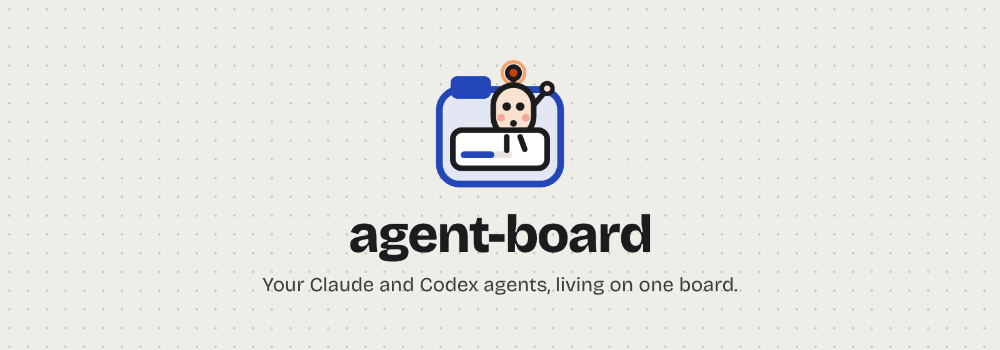
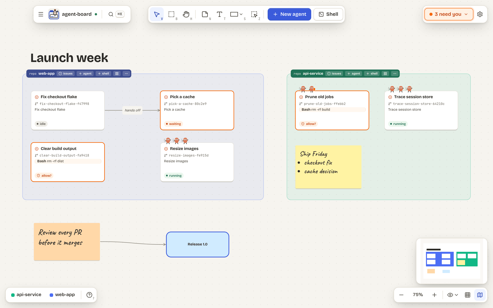
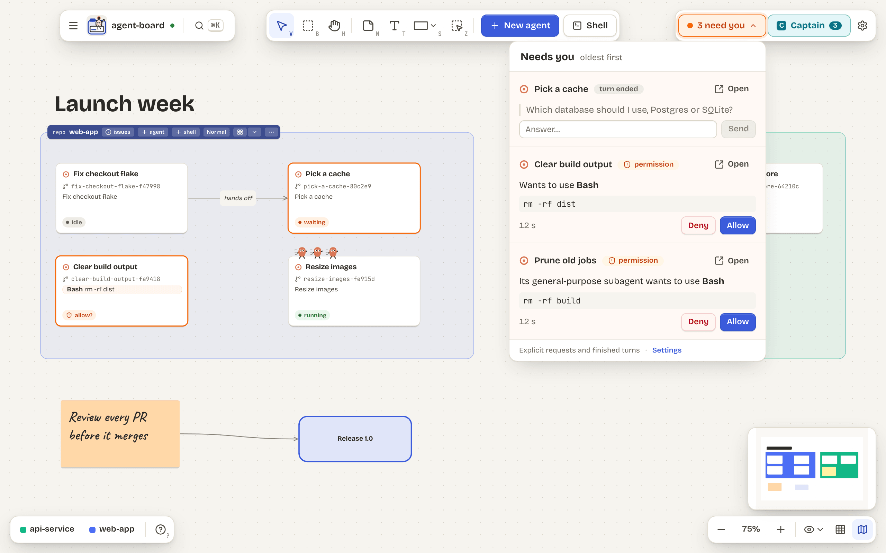
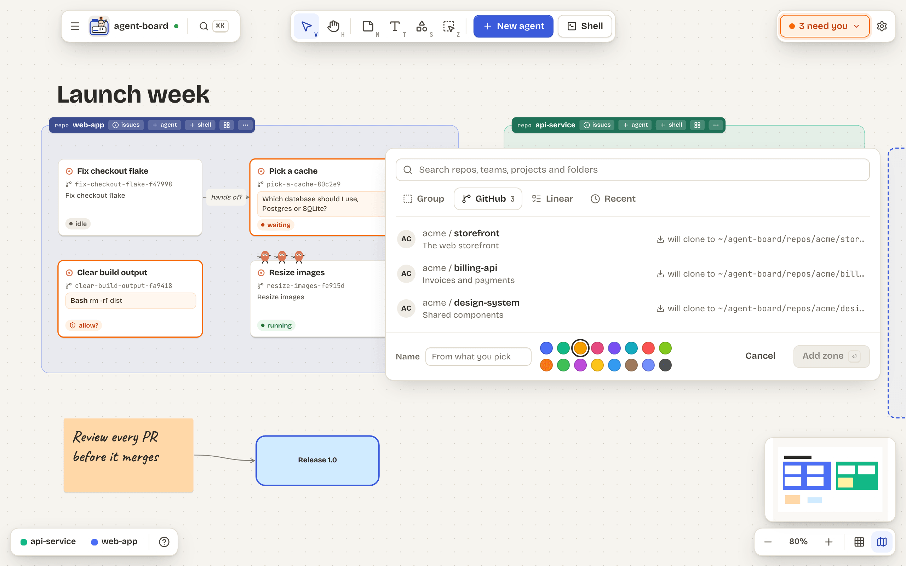
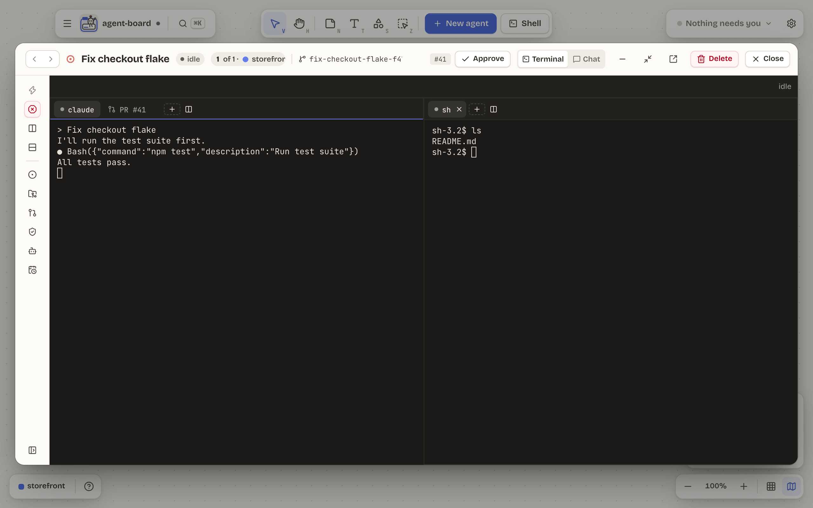
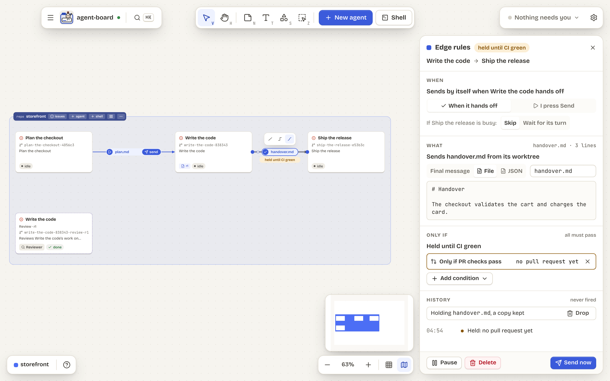
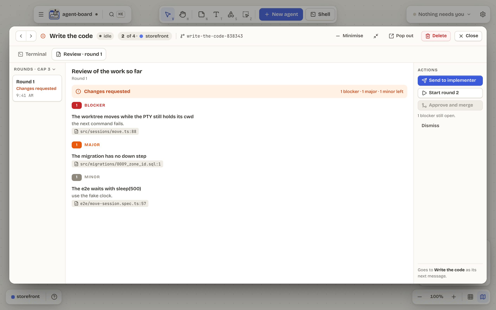
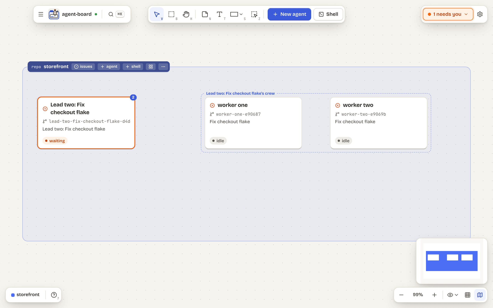

<h1 align="center">
  
</h1>

<p align="center">
  Every Claude Code and Codex session you run, as a tile on one infinite board.<br>
  See which agent is waiting, which wants permission and which is done, and answer it without hunting for its terminal.
</p>

<p align="center">
  <a href="LICENSE"></a>
  
  
</p>

<p align="center">
  
</p>

<p align="center">
  <a href="#tour">Tour</a> ·
  <a href="#install">Install</a> ·
  <a href="#update">Update</a> ·
  <a href="#privacy-and-data">Privacy</a> ·
  <a href="#more">More</a>
</p>

> [!NOTE]
> **Alpha.** agent-board is built for one person on macOS, and it changes fast. Expect rough edges, and please [report them](https://github.com/GarethCa/agent-board/issues).

## Tour

**Answer agents without hunting for their terminals.** The **Needs you** pill counts agents that are waiting or want permission; answer a question, or allow or deny a command, from its popover.

<p align="center">
  
</p>

**Zones for your repos, a worktree for every agent.** A zone is a git repo, a folder, a GitHub repo it clones for you, or a Linear team. Each agent gets its own branch and worktree.

<p align="center">
  
</p>

**A session window for every tile.** The live terminal or a chat view.
It splits into panes of shells.
A PR tab shows checks and diffs.
A gate tab runs your gate command.
A web tab shows your dev server.

<p align="center">
  
</p>

**Agents hand work to agents.** Draw an edge and one agent's final message or `handover.md` goes to the next when it finishes, held until checks or a gate pass if you like.

<p align="center">
  
</p>

**A review loop built in.** **Review its work** starts a reviewer on a branch from the tip of the implementer's; its findings come back by severity, and you send them on, start another round or approve and merge.

<p align="center">
  
</p>

**Agents that know the board.** Every agent can read the board through the `agent-board` command line or its MCP server.
An agent can also hand off on purpose.
If the zone allows, an agent can lead a crew of its own.

<p align="center">
  
</p>

Light and dark themes, a first-run setup that checks your tools, and much more: see the [full tour](docs/tour.md).

## Install

agent-board installs from source, on macOS (Apple silicon or Intel). You need:

- [Node.js](https://nodejs.org) 24 or later, and pnpm 11: `npm install -g pnpm@11`.
- `git`.
- The [`claude`](https://code.claude.com/docs) CLI, installed and logged in. The [`codex`](https://github.com/openai/codex) CLI is optional.
- Optional, for GitHub zones, issues and pull requests on tiles: the [`gh`](https://cli.github.com) CLI, logged in.

The CLIs must be on your login shell's `PATH`: agent-board reads it when it starts, because an app opened from the Dock gets a bare one.

```sh
git clone https://github.com/GarethCa/agent-board.git
cd agent-board
pnpm install
pnpm package
```

`pnpm package` builds an unsigned macOS app and installs it as `~/Applications/agent-board.app`, replacing any earlier copy. If agent-board is running, it quits it first and asks whether to reopen it; your sessions keep running in the daemon. A failed build never removes the app you have. `pnpm package --no-install` only builds.

Then open it: a short first-run flow checks your tools and tours the board. The [quick start](docs/quick-start.md) walks you through your first zone and agent.

## Update

```sh
pnpm update:app
```

Run it in your clone whenever you want the latest release (if the command is missing, `git pull` once first). It fast-forwards the clone, rebuilds and reinstalls the app, and prints the old and new versions. It never runs by itself.

- It refuses, and changes nothing, if the clone has uncommitted changes or has diverged from `origin`.
- If the build fails, the app you have stays installed.
- Sessions keep running in the daemon. If the daemon is older than the new app, a **Restart daemon** banner lets you choose when, since restarting ends running sessions.

Flags such as `--no-launch` and `--install-dir` are in [docs/install.md](docs/install.md#update).

## Privacy and data

- **No keys, no tokens of its own.** It starts your own `claude` and `codex` through your login shell, with their own logins, settings and models. It never sees an Anthropic or OpenAI key, and there is no proxy between you and the CLIs.
- **No terminal scraping.** Each session reports its state through the CLIs' own hooks, to a daemon on your machine. Nothing leaves your machine except what your CLIs and `gh` already send.
- **Nothing approved for you.** Permission prompts wait for you. An edge condition's command only starts after you approve that exact command.
- **Where things live.** Your data is in `~/Library/Application Support/agent-board`, and each agent's worktree is under `~/.agent-board/worktrees/`. Linear keys are kept in the macOS Keychain.

## More

- [Quick start](docs/quick-start.md): your first zone and agent, trackers, and picking up sessions started elsewhere.
- [Tour](docs/tour.md): every feature, with screenshots.
- [FAQ](docs/faq.md): sessions after quitting or a reboot, Linux and Windows, and more.
- [Troubleshooting](docs/troubleshooting.md): `claude` not found, GitHub and Linear logins, the daemon banner, starting over.
- [How it works](docs/how-it-works.md): the daemon, hooks, SQLite and worktrees, with a diagram.
- [Architecture decisions](docs/adr): why it is built the way it is.
- [CONTEXT.md](CONTEXT.md): the words agent-board uses: zone, tile, session, harness, edge.
- [CHANGELOG.md](CHANGELOG.md): what each release changed.
- [CONTRIBUTING.md](CONTRIBUTING.md): development setup, tests (which never spend tokens) and the repo layout.

## Contributing

Contributions are welcome. Read [CONTRIBUTING.md](CONTRIBUTING.md) for setup, conventions and how we test, and follow the [Code of Conduct](CODE_OF_CONDUCT.md). Please don't report vulnerabilities in public issues: [SECURITY.md](SECURITY.md) says how to report one privately.

## Licence

[Functional Source License 1.1, Apache 2.0 future licence](LICENSE) (FSL-1.1-ALv2). You can use, change and share agent-board for anything except a competing commercial product or service, and each release also becomes available under the Apache License 2.0 two years after it ships. Releases up to v0.5.2 were published under the MIT Licence and stay available under it.

Claude and Claude Code are trademarks of Anthropic, PBC. Codex is a trademark of OpenAI. agent-board is an independent project, not affiliated with or endorsed by either company; their names and brand assets are used only to identify the tools agent-board works with, following each owner's brand guidelines.
