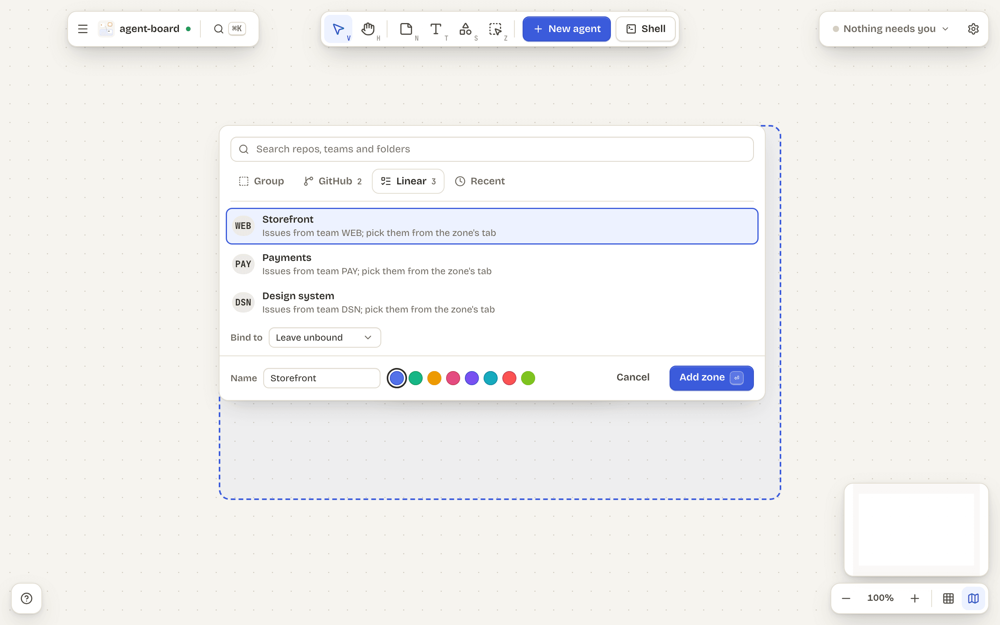
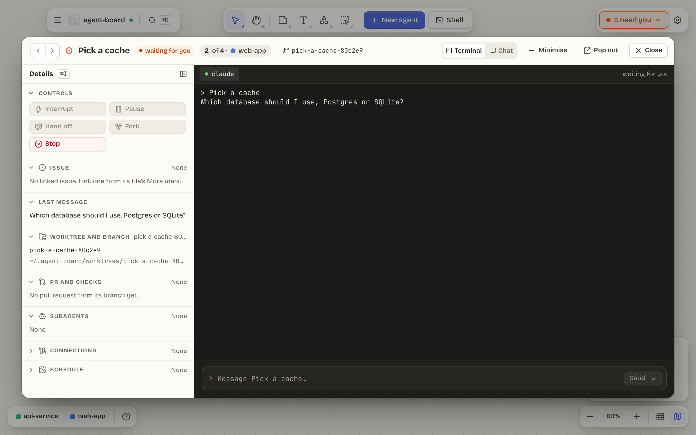
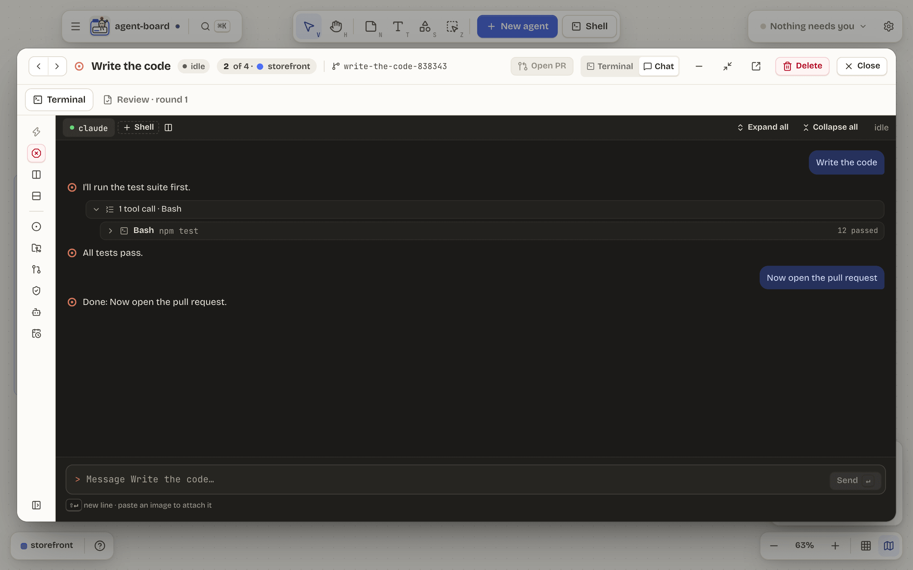
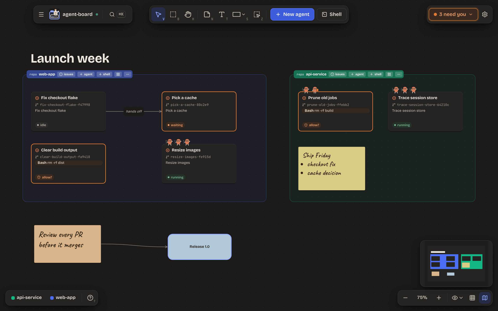
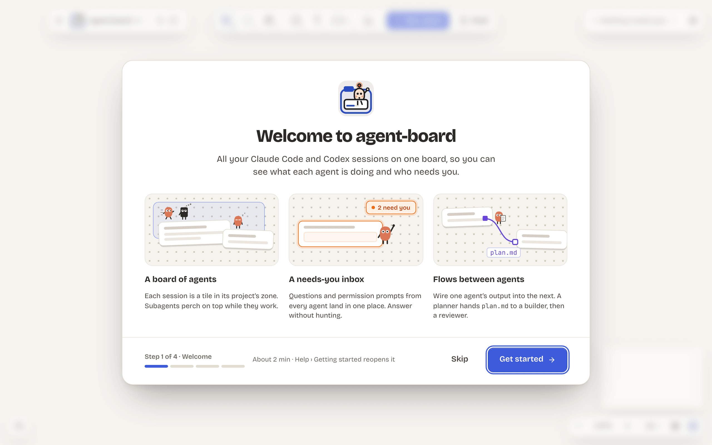
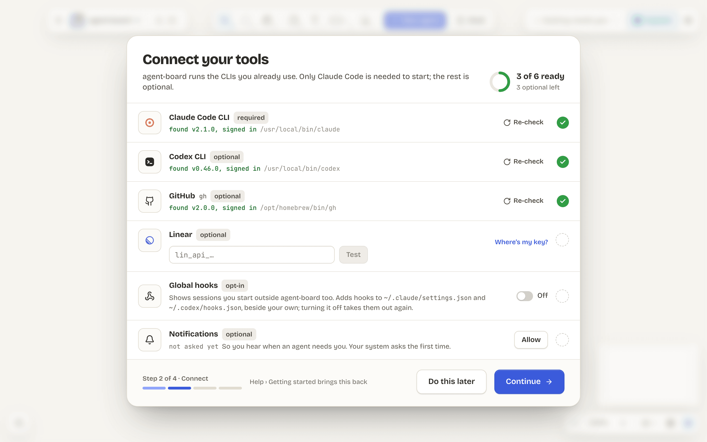
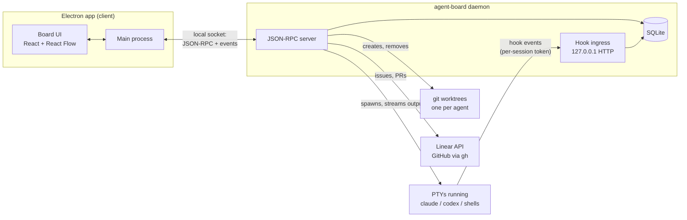

<h1 align="center">
  
</h1>

<p align="center">
  Every Claude Code and Codex session you run, as a tile on one infinite board.<br>
  See which agent is waiting, which wants permission and which is done, and answer it without hunting for its terminal.
</p>

<p align="center">
  <a href="LICENSE"></a>
  
  
</p>

<p align="center">
  
</p>

<p align="center">
  <a href="#install">Install</a> ·
  <a href="#quick-start">Quick start</a> ·
  <a href="#a-tour">Tour</a> ·
  <a href="#faq">FAQ</a> ·
  <a href="#docs">Docs</a>
</p>

## Why

Run more than a couple of coding agents and the terminals win: you lose track of which one is waiting for an answer, which wants permission, which finished an hour ago and which branch each is on. agent-board puts every session on one board, shows its state at a glance, and lets you answer it right there.

- **One place for every agent.** Claude Code and Codex, each in its own git worktree, grouped into zones for your repos.
- **Nothing gets missed.** The **Needs you** pill counts agents that are waiting or asking for permission, and answers them from a popover.
- **Agents hand off to agents.** Draw an edge and one agent's work goes to the next when it finishes, with a review loop built in.
- **Your tools, your logins.** It runs your own `claude`, `codex` and `gh`. No API keys, no proxy, nothing between you and the CLIs.

> [!NOTE]
> **Alpha.** agent-board is built for one person on macOS, and it changes fast. Expect rough edges, and please [report them](https://github.com/GarethCa/agent-board/issues).

## A tour

The screenshots are real captures of the running app, driven by a fake `claude` over a seeded demo board: `pnpm readme:screenshots` makes them again, byte for byte.

### Answer agents without hunting for their terminals

The **Needs you** pill counts agents that are waiting or want permission. Its popover lets you answer a question, or allow or deny a command, right there. Tiles that need you get an orange border, and macOS notifications bring you back.

<p align="center">
  
</p>

### Zones and groups

A **zone** is a tinted region for a project: a git repo, a folder inside one, a GitHub repo agent-board clones for you, or a Linear team. A **group**, drawn dashed, is a zone bound to nothing yet. Each agent is a **tile** with its name, branch, state and last message, and its subagents perch on it as small characters while they work. Stickies, text, shapes, images, link cards and connectors let you annotate the board like a whiteboard.

<p align="center">
  
  
</p>

### A session window for every tile

Double-click a tile for its session window: the live terminal, with the controls, issue, last message, worktree, pull request and subagents beside it. Switch it to [Chat](#chat-view) to read the conversation and answer in a message box. Step through a zone's sessions, minimise to a dock, pop out into a window of its own, or expand the tile in place on the board instead.

<p align="center">
  
</p>

### Flows between agents

An **edge** carries one agent's work to another when the first finishes. Hover an agent's tile and drag from its square **flow port** (below the middle of its right side) onto another agent's tile; its **Edge rules** open on the right.

- **Payload:** the agent's final message, a markdown file from its worktree (`handover.md` unless you name another, such as `plan.md`) or a JSON file (`handoff.json`). A file must sit inside the worktree and be at most 64 KB.
- **Trigger:** automatic when the agent's turn ends, or manual, with a **Send** button on the edge. If the receiver is busy, the delivery is skipped, or waits for its turn to end if you pick **Queue after turn**.
- **Conditions:** an automatic edge can wait until *PR checks* pass, a *gate* command (such as `pnpm check:local`) passes in the sender's worktree, the sender's issue has a label, or a *custom script* exits 0. Gates and scripts only run after you approve the exact command, shown whole ([ADR-0009](docs/adr/0009-edge-condition-approvals.md)). While a condition fails, the hand-off is **held** and checked again, and the edge says what it is held until.
- Each edge keeps its history, and can be paused, deleted or sent now. A hand-off shows travelling along its edge, and the receiver reads "receiving…". Deleting an edge can be undone.

<p align="center">
  
</p>

**A review loop.** From an agent's ⋯ menu, **Review its work** starts an ephemeral **reviewer**: a dashed tile on a branch of its own from the tip of the implementer's, told to read the diff, change nothing and reply with a review doc. When the doc is in, the reviewer stops, and a chip on the implementer's tile opens its window on a **Review** tab: the rounds on the left, the verdict and the findings by severity (blocker, major, minor) with `file:line` chips in the middle, and the actions on the right.

<p align="center">
  
</p>

**Send to implementer** hands the doc back as the agent's next message; **Start round 2** reviews the fixes (up to 3 rounds unless you change the cap), with findings the new round sees fixed struck through; **Approve and merge** squash-merges the agent's pull request once the latest round approves with no open blocker and the checks pass. The loop is implementer, reviewer, implementer again, until the doc approves.

### Agents that know the board

Every agent agent-board starts is told one thing: it is on agent-board, and `agent-board --help` says the rest. That help is the whole manual (zones, tiles, edges, refs and commands), so nothing long is pasted into the agent's prompt and it costs no tokens until the agent asks. Two doors lead to the same place:

- **The `agent-board` command line.** Inside a session it is already on the `PATH`. For your own terminals, **Settings › Command line › Install command-line tool** links it into `~/.local/bin`. It reads the board (`tree`, `zones`, `agents`, `shells`, `edges`, `show <ref>`), and an agent uses it to set its own one-line status, which its tile shows in place of the task. Read commands take `--json`.
- **The board MCP server.** `agent-board mcp` is a small stdio MCP server that Claude and Codex are started with, giving them `whoami`, `board`, `connections` and `set_status` tools. It is on by default; a zone's ⋯ menu has **Turn off board MCP** for agents started there afterwards (the command line stays).

Things are named by short refs such as `zone:cd62` or `agent:22a7`, the first characters of their ids, like git's short hashes. A name works too. An agent sees the board, but it cannot approve another agent's permission prompt, type into a terminal or change a setting ([ADR-0010](docs/adr/0010-board-cli-and-mcp.md)).

This is a real run against the fake `claude` the tests use, with a zone and two agents:

```console
$ agent-board tree
zone:cd62  web-app  (repo ~/code/web-app)
  agent:22a7  Fix the failing login test  [waiting]  task: Fix the failing login test
  agent:e91b  Add dark mode to settings  [waiting]  task: Add dark mode to settings

$ agent-board show agent:22a7
agent:22a7  Fix the failing login test
  state      waiting
  status     not set
  task       Fix the failing login test
  harness    claude
  zone       (in zone:cd62 web-app)
  repo       ~/code/web-app
  branch     fix-the-failing-login-test-0a409e
  worktree   ~/.agent-board/worktrees/web-app-4c737128/fix-the-failing-login-test-0a409e
  last said  All tests pass.
```

### Chat view

Switch a session window from **Terminal** to **Chat** to read the agent's conversation from its transcript: its messages, each tool call as one line that opens to show what went in and how it went, and its subagents' messages. It grows live as the agent works.

<p align="center">
  
</p>

### Light or dark

The **Workbench** theme comes in light and dark. **Settings › Appearance** follows macOS, or picks one.

<p align="center">
  
</p>

### Set up in a minute

On first launch a short flow checks which tools you have (Claude Code, Codex, GitHub, Linear, global hooks, notifications), then tours the board. Everything is skippable.

<p align="center">
  
  
</p>

## Install

agent-board installs from source, on macOS (Apple silicon or Intel). You need:

- [Node.js](https://nodejs.org) 24 or later, and pnpm 11: `npm install -g pnpm@11`.
- `git`.
- The [`claude`](https://code.claude.com/docs) CLI, installed and logged in. The [`codex`](https://github.com/openai/codex) CLI is optional.
- Optional, for GitHub zones, issues and pull requests on tiles: the [`gh`](https://cli.github.com) CLI, logged in.

The CLIs must be on your login shell's `PATH`: agent-board reads it when it starts, because an app opened from the Dock gets a bare one.

```sh
git clone https://github.com/GarethCa/agent-board.git
cd agent-board
pnpm install
pnpm package
open apps/desktop/dist/mac-arm64/agent-board.app   # mac/ on an Intel Mac
```

This builds an unsigned macOS app in `apps/desktop/dist/`. Drag it to `~/Applications` to keep it. To update, `git pull` and run the last two commands again. Your data lives in `~/Library/Application Support/agent-board`.

## Quick start

1. **Add a zone.** Open the board menu (top left) and choose **Add a zone**, or press `Z` and drag one out. Pick a GitHub repo, a Linear team or a recent folder, or start with a group and bind it later.
2. **Start an agent.** Click **New agent** in the zone's tab, choose Claude or Codex, write the task and press **Start**. agent-board makes a worktree and a branch for it, and a tile appears with its live state. **Shell** (`` ` ``) puts a plain shell where you drop it.
3. **Answer it.** When it needs you, the orange **Needs you** pill counts it: answer from the popover, or double-click the tile for its session window.
4. **Connect your trackers.** GitHub needs only `gh auth login`. Linear needs a personal API key, which agent-board keeps in the macOS Keychain. Start an agent from an issue and its branch is named after it.
5. **Pick up sessions started elsewhere.** Turn on **Global hooks** in onboarding (Help › Getting started), and a `claude` or `codex` started in any terminal shows up as a tile you can resume inside agent-board.

Quit the app and open it again: every agent and shell is still running, because a background daemon owns them.

## FAQ

**Does agent-board need my API keys, or spend tokens of its own?**
No. It starts your own `claude` and `codex` through your login shell, with their own logins, settings and models. It never sees an Anthropic or OpenAI key. Its test suite runs on fake CLIs and spends no tokens at all.

**Does it read my terminal to know what an agent is doing?**
No. Each session it starts reports its state through the CLIs' own hooks, to a daemon on your machine ([ADR-0004](docs/adr/0004-agent-telemetry.md)). Nothing leaves your machine except what your CLIs and `gh` already send.

**What happens to my sessions when I close the app?**
They keep running. A background process, `agent-board daemon`, owns them, and the app reconnects when it opens. After a reboot, their tiles keep their last output and offer **Resume**.

**Where does it put my code?**
Each agent works in its own git worktree under `~/.agent-board/worktrees/`, on its own branch, so agents never trip over each other or your checkout.

**Does it approve things for my agents?**
No. It does what the CLIs do and no more: permission prompts wait for you, in the inbox or the terminal. Edge conditions that run a command run only after you approve that exact command ([ADR-0009](docs/adr/0009-edge-condition-approvals.md)).

**Linux or Windows?**
macOS is the supported platform today. The end-to-end tests pass on Linux, but it is not packaged yet; Windows comes later.

**Is it made by Anthropic or OpenAI?**
No. agent-board is an independent project, not affiliated with or endorsed by either.

## Docs

- [`CONTEXT.md`](CONTEXT.md): the words agent-board uses (zone, tile, session, harness, edge).
- [`docs/adr/`](docs/adr): the architecture decisions and why they were made.
- [`CHANGELOG.md`](CHANGELOG.md): what each release changed.
- [CONTRIBUTING.md](CONTRIBUTING.md): setup, conventions and how we test.

## Under the hood

### How it works



- **The app is a client.** Sessions, PTYs and the database live in a separate background process, `agent-board daemon`. The app starts it if it isn't running and talks to it over a local socket. That is what lets sessions survive closing a window or restarting the app. ([ADR-0002](docs/adr/0002-session-daemon.md))
- **State comes from hooks, never from scraping the terminal.** Each spawned session gets per-session hook config and a token, and its `claude` or `codex` reports state changes to the daemon over localhost HTTP. ([ADR-0004](docs/adr/0004-agent-telemetry.md))
- **One SQLite database**, owned by the daemon and changed only through forward-only migrations. ([ADR-0005](docs/adr/0005-storage.md))
- **Each agent gets its own git worktree**, outside your repo under `~/.agent-board/worktrees`. ([ADR-0007](docs/adr/0007-worktree-location.md))
- **Trackers sit behind one interface** in `packages/tracker`: Linear over its API with a key in the macOS Keychain, GitHub through your `gh` login. Their tests replay recorded responses.

The rest of the decisions are in [`docs/adr/`](docs/adr):

- [Electron + TypeScript](docs/adr/0001-app-shell.md)
- [React Flow for the board](docs/adr/0003-board-library.md)
- [The terminal backend seam](docs/adr/0006-terminal-backends.md)
- [The in-repo design system](docs/adr/0008-design-system.md)
- [Approving what edge conditions run](docs/adr/0009-edge-condition-approvals.md)
- [The board CLI and MCP](docs/adr/0010-board-cli-and-mcp.md)

The domain vocabulary (zone, tile, session, harness, edge…) is in [`CONTEXT.md`](CONTEXT.md).

### Troubleshooting

**The Connect step says `claude` isn't found.** The daemon looks on your login shell's `PATH`. Check that `which claude` works in a fresh terminal, fix your shell profile if not, then click **Re-check**. `~/Library/Application Support/agent-board/daemon.log` says which `PATH` it adopted.

**An agent starts and then fails straight away.** Run `claude` in a terminal first: it must be logged in, and it may be waiting for you to trust the folder or accept its terms.

**Codex asks me to review hooks.** If a repo has Codex config of its own, agent-board explains it before it starts an agent there. This is Codex's hook trust, and it is expected.

**GitHub says it needs a login.** Run `gh auth status` and, if needed, `gh auth login`, then reopen Add zone.

**Linear rejects my key.** Make a new personal API key, with access to the teams you want, and paste it again. To remove a stored key: `security delete-generic-password -s agent-board -a linear`.

**A banner says the daemon is from an older build.** The daemon outlives the app by design, so after an upgrade it can be the old one. Click **Restart daemon**; it warns first if sessions are running, because restarting ends them.

**"Delete agent" stops short.** The agent's worktree has uncommitted changes, or its branch has commits no other branch has. Push or merge them, or confirm that you want them gone.

**Start over.** Quit the app, stop the daemon and delete its data directory, then `rm -rf ~/Library/Application\ Support/agent-board`. Agent worktrees stay under `~/.agent-board/worktrees/` because they may hold unpushed work.

Anything else: search the [issues](https://github.com/GarethCa/agent-board/issues), and when you open one, include the build from the window title.

### Development

`pnpm --filter @agent-board/desktop dev` runs the app with hot reload. `pnpm check:pr` runs the checks a branch's diff needs and prints why; `pnpm check:local` is the full gate: lint, typecheck, unit tests, the build, the Playwright end-to-end and visual tests, the Markdown lint and knip. [CONTRIBUTING.md](CONTRIBUTING.md#tests) lists every command.

**Tests never spend tokens.** They run the fake `claude` and `codex` in [`packages/fake-harness`](packages/fake-harness/README.md) instead of the real CLIs, and a guard fails the run if anything reaches a real one.

### Repo layout

```text
apps/desktop/          Electron app: main process, preload, React renderer, Playwright e2e and visual tests
packages/daemon/       agent-board daemon: JSON-RPC over a local socket, hook ingress, SQLite migrations
packages/fake-harness/ Fake claude/codex CLIs and the guard that keeps tests off the real ones
packages/tracker/      Issue trackers (Linear, GitHub) behind one interface, recorded-HTTP fixtures, keychain credentials
fixtures/              Real Codex hook payloads captured for tests
docs/adr/              Architecture decision records
docs/assets/           Logo and the README's screenshots
scripts/               Dev scripts: readme-screenshots redraws the README's screenshots; visual and check-local run the merge gate; codex-capture records real Codex hook payloads into fixtures/
CONTEXT.md             Domain glossary
```

## Contributing

Contributions are welcome. Read [CONTRIBUTING.md](CONTRIBUTING.md) for setup, conventions and how we test, and follow the [Code of Conduct](CODE_OF_CONDUCT.md). Please don't report vulnerabilities in public issues: [SECURITY.md](SECURITY.md) says how to report one privately.

## Licence

[MIT](LICENSE).

Claude and Claude Code are trademarks of Anthropic, PBC. Codex is a trademark of OpenAI. agent-board is an independent project, not affiliated with or endorsed by either company; their names and brand assets are used only to identify the tools agent-board works with, following each owner's brand guidelines.
