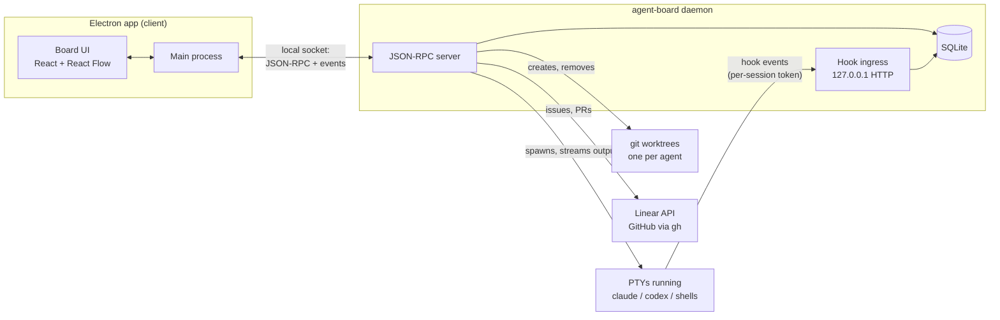

# How it works

- **The app is a client.** Sessions, PTYs and the database live in a separate background process, `agent-board daemon`. The app starts it if it isn't running and talks to it over a local socket. That is what lets sessions survive closing a window or restarting the app. ([ADR-0002](adr/0002-session-daemon.md))
- **State comes from hooks, never from scraping the terminal.** Each spawned session gets per-session hook config and a token, and its `claude` or `codex` reports state changes to the daemon over localhost HTTP. ([ADR-0004](adr/0004-agent-telemetry.md))
- **One SQLite database**, owned by the daemon and changed only through forward-only migrations. ([ADR-0005](adr/0005-storage.md))
- **Each agent gets its own git worktree**, outside your repo under `~/.agent-board/worktrees`. ([ADR-0007](adr/0007-worktree-location.md))
- **Trackers sit behind one interface** in `packages/tracker`: Linear over its API with a key in the macOS Keychain, GitHub through your `gh` login. Their tests replay recorded responses.

The rest of the decisions are in [`docs/adr/`](adr):

- [Electron + TypeScript](adr/0001-app-shell.md)
- [React Flow for the board](adr/0003-board-library.md)
- [The terminal backend seam](adr/0006-terminal-backends.md)
- [The in-repo design system](adr/0008-design-system.md)
- [Approving what edge conditions run](adr/0009-edge-condition-approvals.md)
- [The board CLI and MCP](adr/0010-board-cli-and-mcp.md)
- [Orchestrators](adr/0011-orchestrators.md)
- [Explicit hand-off and agent-made edges](adr/0012-explicit-handoff-and-agent-made-edges.md)
- [The merge gate](adr/0013-merge-gate.md)
- [Questions and plans](adr/0014-questions-and-plans.md)

The domain vocabulary (zone, tile, session, harness, edge…) is in [`CONTEXT.md`](../CONTEXT.md).
