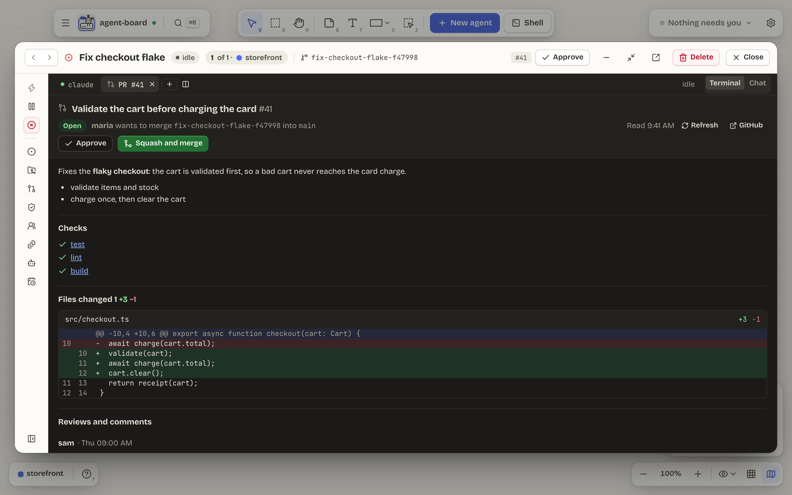
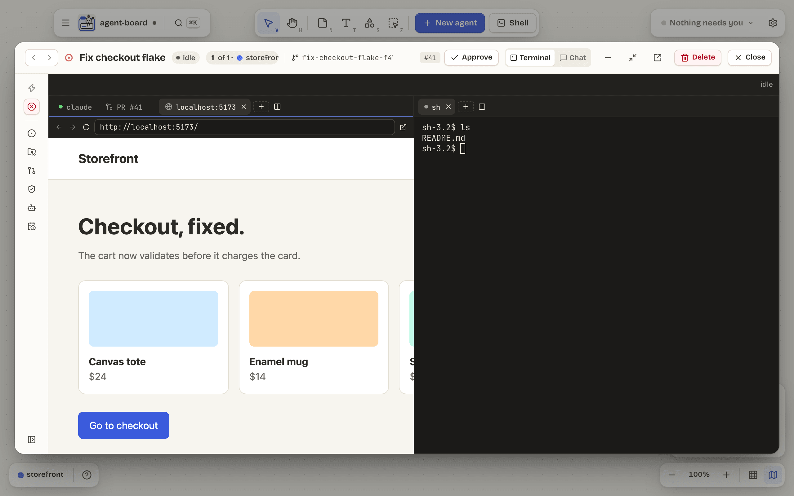

# Tour

The screenshots are real captures of the running app, driven by a fake `claude` over a seeded demo board: `pnpm readme:screenshots` makes them again, byte for byte.

## Answer agents without hunting for their terminals

The **Needs you** pill counts agents that are waiting or want permission. Its popover lets you answer a question, or allow or deny a command, right there. Tiles that need you get an orange border, and macOS notifications bring you back.

An agent can also ask you through the board: a question with a button per answer (or a reply in your own words, or Skip), or a plan for you to approve, send back with comments or reject, which opens in a **Plan** tab with its versions. Its call waits until you answer; nothing answers for you, and an HTML plan runs offline in a locked-down view of its own ([ADR-0014](adr/0014-questions-and-plans.md)).

<p align="center">
  
</p>

## Zones and groups

A **zone** is a tinted region for a project: a git repo, a folder inside one, a GitHub repo agent-board clones for you, or a Linear team. A **group**, drawn dashed, is a zone bound to nothing yet. Each agent is a **tile** with its name, branch, state and last message, and its subagents perch on it as small characters while they work. Stickies, text, shapes, images, link cards and connectors let you annotate the board like a whiteboard.

When you add a zone for a GitHub repo you already have cloned, it can use that copy (**Use my copy…**, or **Find my local copies**) instead of a fresh clone, and the **File browser** tab picks a folder that isn't listed. Any zone can be deleted, with ⌫, its context menu or its ⋯ menu, and the delete can be undone.

When you start an agent, the chips beside the task pick its model and, optionally, a role: implementer, reviewer, follow-up reviewer or custom. A role starts the agent with its zone's role template, filled in, and shows as a badge on its tile. A reviewer reads a branch on a detached checkout, so it has no branch of its own to push.

<p align="center">
  
</p>

## A session window for every tile

Double-click a tile for its session window: the live terminal, with the controls, issue, last message, worktree, pull request and subagents beside it. Switch it to [Chat](#chat-view) to read the conversation and answer in a message box. Step through a zone's sessions, minimise to a dock, pop out into a window of its own, or expand the tile in place on the board instead.

<p align="center">
  
</p>

A window is laid out in **panes**, and each pane has its own tab strip: the agent's own tab, then shells and any other session you show there. **+** or ⌘T opens a shell in the focused pane, and ⌘D splits it. Drag a tab along its strip to reorder it, onto another pane's strip to move it there, or onto the edge of a pane to split a new pane off. Closing a pane's last tab closes the pane.

<p align="center">
  
</p>

Tabs move too. Drag a tab, or a split pane, onto another agent's window to move it there, or out onto the board to make it a tile of its own; drag a shell tile onto an agent to bring it in as a tab.

An agent's pull request opens as a **PR tab**, from the PR chip on its tile: the description, checks, each file's diff and the review comments, read from GitHub through `gh`, with **Approve** and **Squash and merge** when GitHub allows them, each asking first.

<p align="center">
  
</p>

A zone can have a **gate command**, such as `pnpm check:local`, set from its tab's ⋯ menu. **Run gate** (⌘⇧G, the details' Gate section or the tile's ⋯) runs it in the agent's worktree, only when you ask, into a **Gate tab**: its steps as a table, the picked step's log streaming under it, and on a failure **Send failure**, which pastes the failing lines at the agent's prompt for you to send. The window's header offers **Open PR**, which pushes the branch and opens a pull request from the repo's template and the agent's `.agent-board/handover.md`, and **Merge**, which squash-merges only once GitHub's checks are green and, in a zone with a gate, the gate passed on the pull request's head. A PR tab may merge it before the gate passed there, once you confirm going past the gate. An agent may open its own pull request too (`agent-board open-pr`), always as a draft. The command runs through `sh -c`, so `&&` and pipes work ([ADR-0013](adr/0013-merge-gate.md)).

A dev server opens as a **web tab**: **Web…** in the + menu, or ⌘-click a `localhost` address in a terminal. It is a locked-down web view that shows only https pages and http ones on your machine, in a session of its own, with no access to the app.

<p align="center">
  
</p>

## Flows between agents

An **edge** carries one agent's work to another when the first finishes. Hover an agent's tile and drag from one of its round handles onto another agent's tile, then pick **Hand off** (or press H) in the chooser; **Arrow**, the default, keeps a plain arrow. Hold **⌥** while dragging to make a hand-off straight away. Its **Edge rules** open on the right, in four sections: When, What, Only if and History. Like an arrow, an edge is straight, elbow or curved, can be bent by dragging the handle halfway along it, and its ends dragged to other sides of their tiles.

- **Payload:** the agent's final message, a markdown file from its worktree (`handover.md` unless you name another, such as `plan.md`) or a JSON file (`handoff.json`). A file must sit inside the worktree and be at most 64 KB.
- **Trigger:** automatic when the agent hands off (it runs `agent-board handoff`, or calls the board MCP's `handoff` tool, once its work is ready) or else when its turn ends, or manual, with a **Send** button on the edge. If the receiver is busy, the delivery is skipped, or waits for its turn to end if you pick **Wait for its turn**.
- **Conditions:** an automatic edge can wait until *PR checks* pass, a *gate* command (such as `pnpm check:local`) passes in the sender's worktree, the sender's issue has a label, or a *custom script* exits 0. Gates and scripts only run after you approve the exact command, shown whole under the condition ([ADR-0009](adr/0009-edge-condition-approvals.md)). While a condition fails, the hand-off is **held** and checked again, and the edge says what it is held until.
- Each edge keeps its history, and can be paused, deleted or sent now. A hand-off shows travelling along its edge, and the receiver reads "receiving…". Deleting an edge can be undone.

<p align="center">
  
</p>

**A review loop.** From an agent's ⋯ menu, **Review its work** starts an ephemeral **reviewer**: a dashed tile on a branch of its own from the tip of the implementer's, told to read the diff, change nothing and reply with a review doc. When the doc is in, the reviewer stops, and a chip on the implementer's tile opens its window on a **Review** tab: the rounds on the left, the verdict and the findings by severity (blocker, major, minor) with `file:line` chips in the middle, and the actions on the right.

<p align="center">
  
</p>

**Send to implementer** hands the doc back as the agent's next message; **Start round 2** reviews the fixes (up to 3 rounds unless you change the cap), with findings the new round sees fixed struck through; **Approve and merge** squash-merges the agent's pull request once the latest round approves with no open blocker and the checks pass. The loop is implementer, reviewer, implementer again, until the doc approves.

## Agents that know the board

Every agent agent-board starts is told one thing: it is on agent-board, and `agent-board --help` says the rest. That help is the whole manual (zones, tiles, edges, refs and commands), so nothing long is pasted into the agent's prompt and it costs no tokens until the agent asks. Two doors lead to the same place:

- **The `agent-board` command line.** Inside a session it is already on the `PATH`. For your own terminals, **Settings › Command line › Install command-line tool** links it into `~/.local/bin`. It reads the board (`tree`, `zones`, `agents`, `shells`, `edges`, `show <ref>`), and an agent uses it to set its own one-line status, which its tile shows in place of the task. Read commands take `--json`.
- **The board MCP server.** `agent-board mcp` is a small stdio MCP server that Claude and Codex are started with, giving them `whoami`, `board`, `connections` and `set_status` tools. It is on by default; a zone's ⋯ menu has **Turn off board MCP** for agents started there afterwards (the command line stays).

An agent can also hand off on purpose. `agent-board handoff` (or the `handoff` MCP tool) sends a message over one of the agent's own edges, and `agent-board edge list` shows them. An [orchestrator](#orchestrators) can wire its crew with `agent-board edge add` and `edge remove`; an edge an agent made is drawn dashed and says who made it, and the agent can remove only its own ([ADR-0012](adr/0012-explicit-handoff-and-agent-made-edges.md)).

Things are named by short refs such as `zone:cd62` or `agent:22a7`, the first characters of their ids, like git's short hashes. A name works too. An agent sees the board, but it cannot approve another agent's permission prompt, type into a terminal or change a setting ([ADR-0010](adr/0010-board-cli-and-mcp.md)).

This is a real run against the fake `claude` the tests use, with a zone and two agents:

```console
$ agent-board tree
zone:cd62  web-app  (repo ~/code/web-app)
  agent:22a7  Fix the failing login test  [waiting]  task: Fix the failing login test
  agent:e91b  Add dark mode to settings  [waiting]  task: Add dark mode to settings

$ agent-board show agent:22a7
agent:22a7  Fix the failing login test
  state      waiting
  status     not set
  task       Fix the failing login test
  harness    claude
  zone       (in zone:cd62 web-app)
  repo       ~/code/web-app
  branch     fix-the-failing-login-test-0a409e
  worktree   ~/.agent-board/worktrees/web-app-4c737128/fix-the-failing-login-test-0a409e
  last said  All tests pass.
```

### Orchestrators

An agent can lead other agents the way you would: start one with a task, wait for its turn to end, read what it handed back, send a follow-up and close it. The commands are `new`, `send`, `wait`, `read`, `interrupt` and `close`, with matching MCP tools, and they work from any shell on the board or your own terminal too, where they act for you; `agent-board help orchestrate` shows the loop.

- **On by default, per zone.** A zone's ⋯ menu has **Stop agents orchestrating** / **Let agents orchestrate**. With it on, an agent in the zone may start and steer agents in that zone, and only there. Switch it off and they stop at their next call. Or grant it one agent at a time from your own terminal: `agent-board orchestrate on agent:22a7 --scope zone` (`repo` and `board` widen the scope).
- **Crews go three deep.** An agent an orchestrator starts runs in its own worktree and branch, and leads its own crew only as its zone allows, three agents deep at most. Its permission prompts come to your **Needs you** inbox, never to the orchestrator.
- **Crew frames.** An orchestrator's agents sit beside it in a dashed frame labelled with its name, which moves with it. **Settings › Board** can show a "from" chip on each agent instead.
- **An Activity tab.** The orchestrator's session window gets an **Activity** tab listing what it started, sent, interrupted and closed, and what it tried and was refused, with why.

<p align="center">
  
</p>

An orchestrator cannot answer a permission prompt, type raw keys, change a permission mode or a setting, or open a message with a command such as `/model` or `!`. It runs as you, so this limits what the board offers it, not what a determined agent could do on your machine ([ADR-0011](adr/0011-orchestrators.md)).

## Chat view

Switch a session window from **Terminal** to **Chat** to read the agent's conversation from its transcript: its messages, each tool call as one line that opens to show what went in and how it went, and its subagents' messages. It grows live as the agent works.

<p align="center">
  
</p>

## Light or dark

The **Workbench** theme comes in light and dark. **Settings › Appearance** follows macOS, or picks one.

<p align="center">
  
</p>

## Set up in a minute

On first launch a short flow checks which tools you have (Claude Code, Codex, GitHub, Linear, global hooks, notifications), then tours the board. Everything is skippable.

<p align="center">
  
  
</p>
